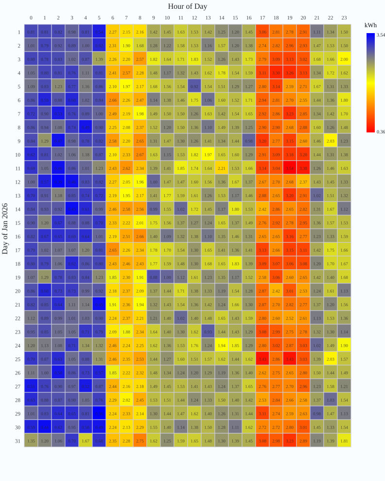
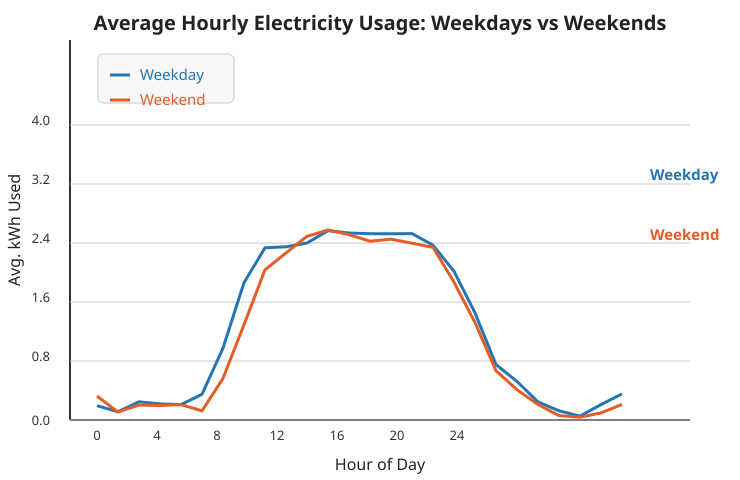

# Output from the live plotting example

These are the original files from the successful November 3, 2026 run with GPT-4.1, microsandbox 0.7.13, and Pydantic AI 2.65.0 on macOS Apple silicon. The first run generated 744 hourly readings and a heatmap. The second run reattached by workspace reference and generated the weekday/weekend comparison. Assertions verified that the CSV and original heatmap stayed byte-for-byte unchanged.

The [runnable example](../microsandbox_plotting.py) preserves the tested prompts and assertions, with authentication and output paths made portable. It reads `OPENAI_API_KEY` from the host environment and saves new results in `microsandbox-plotting-output/` in the current directory. Model-generated plots can vary between runs.

Run from the source checkout with `microsandbox`, `openai`, and `pydantic-ai-harness[coder]` installed:

```sh
PYTHONPATH=src/pydantic_ai_harness python examples/pydantic_ai_examples/microsandbox_plotting.py
```

The script checks both plots and retained data, downloads the files, and deletes the VM. [result.json](result.json) records the successful run and [usage.csv](usage.csv) contains the synthetic data.




